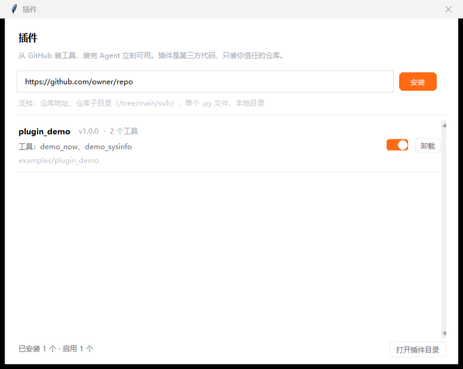

# 墟 — 有闭环、有边界、可扩展的桌面 Agent（Python / 零依赖）

一个能自己动手解决问题的通用 Agent。内核是一个带自检的 ReAct 闭环：

```
用户提问 → 准备上下文 → 模型规划 → 调工具 → 边界检查 → 结果回填 → 更新完成度
        ↑                                                          │
        └──────────────── 没完成就再来一轮（含出口自评返工）──────────┘
```

只用 Python 标准库，不装任何第三方包。界面是桌面应用：左侧栏导航，右侧对话，底部悬浮输入卡。




## 分层

| 层 | 目录 | 职责 | 依赖 |
| --- | --- | --- | --- |
| 交互层 | `miniagent/ui/` | 界面、命令行、插件窗口 | → core, plugins |
| 核心层 | `miniagent/core/` | 内核循环、上下文管理、状态观测、边界、完成度判定 | → model, tools, skills |
| 工具层 | `miniagent/tools/` | 内置工具：shell / python / 文件 / **文档解析** / 技能加载 / 网页 | → skills, plugins |
| 技能层 | `miniagent/skills/` | `skills/*.md` 按需加载的知识 | → config |
| 插件层 | `miniagent/plugins/` | 从 GitHub 装第三方工具，可开关可卸载 | → config |
| MCP 层 | `miniagent/mcp/` | 外部工具进程（JSON-RPC over stdio）+ schema 压缩 | → config, tokens |
| 模型层 | `miniagent/model/` | 协议适配（4 种原生协议）+ 供应商目录（37 家）+ 自定义模型 + 传输客户端 | → config |

依赖单向：`ui → core → tools → (skills, plugins, mcp) → config`。核心层只认 `Sink` 事件接口，
换界面、加插件、加技能、接 MCP 都不用碰循环逻辑。

`tokens.py` 是唯一的叶子模块（只依赖 `re`）：核心层、工具层、MCP 层都要估 token，
谁都不该为了估个数去 import 整个 core，那会把导入链绕成环。

```
mini_agent/
├─ agent.py              命令行入口（薄）
├─ gui.py                图形界面入口（薄）
├─ 启动GUI.vbs           双击启动，不出现黑窗口
├─ rules.md              运行时规则，注入系统提示词（每轮都发，所以短）
├─ agent.md              开发约定，给 AI 编码助手看的，运行时不读
├─ assets/icon.ico       应用图标（icon-source.png 是原图，改图标重跑生成脚本）
├─ skills/               技能库（.md），code-review 是示例
├─ examples/plugin_demo/ 插件写法示例
├─ plugins/              装进来的插件（不进版本库）
├─ .agent/records/       工具调用记录（不进版本库）
└─ miniagent/
   ├─ config.py          .env、密钥、路径、上下文预算
   ├─ mcp/                外部工具进程
   │  ├─ client.py       stdio JSON-RPC 传输
   │  ├─ schema.py       token 压缩：schema → 最小子集
   │  └─ manager.py      配置、懒启动、注册表对接
   ├─ model/
   │  ├─ client.py      传输：发请求、重试、拼流
   │  ├─ wire.py        协议无关的统一事件
   │  ├─ registry.py    48 个模型条目 / 37 家供应商
   │  └─ protocols/     openai / anthropic / gemini / responses

   ├─ core/
   │  ├─ loop.py         内核循环（Agent 类）
   │  ├─ context.py      上下文管理：token 估算、裁剪、摘要、记录
   │  ├─ state.py        状态观测：阶段 / 完成度 / 上下文占用 / token
   │  ├─ rules.py        边界：rules.md 注入 + 读写白名单 + 命令黑名单
   │  ├─ completion.py   完成度判定：快判 + 出口自评
   │  ├─ search.py       搜索：对话 / 任务 / 产物 三类来源
   │  └─ prompt.py       系统提示词（拼 rules.md 与技能清单）
   ├─ tools/
   │  ├─ runtime.py      run_shell / run_python
   │  ├─ filesystem.py   read_file / write_file / list_dir
   │  ├─ documents.py    read_document：docx / xlsx / pdf / 文本 / 图片元信息
   │  ├─ skills_tool.py  use_skill / list_skills
   │  └─ web.py          http_get
   ├─ skills/            技能发现与解析
   ├─ plugins/           插件安装 / 启停 / 加载
   └─ ui/
      ├─ window.py       主窗口：侧栏、聊天区、输入卡
      ├─ console.py      命令行界面
      ├─ dialogs.py      插件管理窗口
      ├─ settings_dialog.py  设置窗口 + 添加模型窗口
      ├─ search_dialog.py    搜索窗口
      ├─ settings.py     界面偏好读写（.agent/settings.json）
      ├─ theme.py        三套调色板 + 字体 + DPI
      └─ widgets.py      自绘控件：圆角按钮、开关、头像、悬浮提示
```

## 快速开始

**图形界面（推荐）**：双击 `启动GUI.vbs`。

```bash
cd mini_agent
cp .env.example .env          # 填 DEEPSEEK_API_KEY

python agent.py                       # 交互模式
python agent.py -p "统计项目有多少行代码"
python agent.py --safe                # 危险操作前确认
python agent.py --selftest            # 不需要 Key 的自检
```

> GUI 需要带 tkinter 的解释器：本机 `C:\Python314\pythonw.exe` 有，默认那个 3.13 没有。

## 能读什么文件

`read_document` 按扩展名分派，全靠标准库：

| 类型 | 做法 | 能力边界 |
| --- | --- | --- |
| `.docx` | zip 里取 `word/document.xml`，按段落拼 `w:t` | 读正文文字，不保留样式/表格结构 |
| `.xlsx` | zip 里读 sharedStrings + 工作表 xml，按行列输出 | 读单元格值，不含公式计算结果 |
| `.pdf` | 解 FlateDecode → 按 `BT/ET` 文本块扫描 → 认 ToUnicode 映射 | 扫描件要 OCR，做不到；无 ToUnicode 的 CID 字体也解不出 |
| `.md/.txt/.csv/.json/代码` | 直接读 | 按 UTF-8，乱码会替换 |
| 图片 | 读 PNG/JPEG 头拿尺寸和大小 | **读不了画面内容**，只能告诉你尺寸 |

PDF 那块是这套工具里最"脏"的部分：真实 PDF 里的文字可能是字形编号（如 `<01020303>`），
必须靠 ToUnicode CMap 才能还原成文字；没有映射表就如实说"做不到"，而不是输出乱码。

界面上点「📎 附件」选文件，会自动把路径写进输入框，并把这个文件临时加入读白名单（只放开这一个路径）。

## 技能（skill）

技能是**知识**，插件是**工具**。前者告诉 Agent 该怎么做，后者给它新的手脚。

```
skills/code-review.md
---
# code-review

> 用户让你审代码、review PR 时用

正文：先跑起来看结果，再按「会不会坏 / 好不好改 / 该不该写」三层说……
```

- 清单（名字 + 一句描述）常驻系统提示词，很省 token
- 正文要模型主动调 `use_skill("code-review")` 才加载，避免方法论塞满上下文
- 加技能就是往 `skills/` 放一个 `.md`，下一句话就生效，不用重启
- 额外目录用 `AGENT_SKILLS_DIR`（分号分隔）挂进来
- **能装了**：插件窗口填 GitHub 地址点「装为技能」（或 CLI `/skill 地址`）。支持仓库、子目录、单个 .md、本地路径。技能是纯 Markdown 不执行代码，安装确认话术与插件不同。子目录扁平化成「目录_文件」防同名冲突

## MCP：接外部工具进程

工具层现在有三个来源，走的是同一个出口：

| 来源 | 形态 | 怎么加 |
| --- | --- | --- |
| 内置 | 本仓库的 Python | 写 SCHEMAS/HANDLERS |
| 插件 | 本地 Python，同进程 | 界面里从 GitHub 装 |
| **MCP** | **外部进程，JSON-RPC over stdio** | **界面里填一行启动命令** |

入口：侧栏「插件」→ 顶部那行「管理 MCP」。或者直接写 `.agent/mcp.json`：

```json
{ "servers": [{
    "name": "fs",
    "command": "npx",
    "args": ["-y", "@modelcontextprotocol/server-filesystem", "D:\资料"],
    "tools": ["read_file", "list_directory"],
    "enabled": true
}] }
```

加完点「同步」拉一次工具清单，工具名会变成 `mcp__fs__read_file` 进注册表，下一句话模型就能调。

实际跑过的例子（用仓库自带的假 server，不联网）：

```
↳ mcp__fake__add {"a": 37, "b": 5}
42
```

### token 策略：这是接 MCP 最贵的地方

一个 MCP server 动辄二三十个工具，schema 全是完整的 JSON Schema。原样塞进去，
还没开始干活就先烧掉几千 token。所以做了四层：

| 层 | 做法 | 效果（22 个工具实测） |
| --- | --- | --- |
| 1. 压缩 | 抠掉 `$schema` / `title` / `additionalProperties` / `default` / `examples`，描述按 **token** 截断而不是字符 | 6313 → 3508 tok |
| 2. 白名单 | 每个 server 只注入你勾选的工具，空 = 全部 | 按需 |
| 3. 预算 | 总预算默认 1500 tok，按白名单顺序排队；超出的降级成一行签名 | 3508 → 1480 tok |
| 4. 元工具 | 降级的那批用 `mcp_call(server, tool, args)` 兜底 | 15 个工具 465 tok 的摘要，全量注入要 2236 |

**22 个工具从 6313 token 压到 1480，省 77%。** 预算可以用 `AGENT_MCP_TOOL_TOKENS` 调，设 0 就是全部降级。

三个容易被忽略的细节：

- **描述按 token 截，不按字符**。同样 150 个字符，英文约 37 token，中文是 150 —— 按字符卡的话中文描述会悄悄吃掉四倍预算。
- **摘要也算进预算**。第一版没扣，结果「1500 的预算」实际花到 1767；现在先算一遍拿到降级清单、算出摘要开销、再扣掉重算。
- **图片绝不进上下文**。MCP 返回的 `image` 块是 base64，一张图几万 token。现在只留一句 `[image image/png，约 780 KB 已省略]`。同理，返回文本超过 `max_result`（默认 4000 字符）会截断。

### 懒启动：不接 MCP 的人零开销

工具清单缓存在 `.agent/mcp-cache/{server}.json`，key 是启动命令的指纹。

- 开会话时只读缓存，**不拉进程**。
- 真要用到某个工具才起子进程，用完留在池子里复用。
- 命令改了 → 指纹对不上 → 缓存作废，需要重新同步。

所以「配了 MCP 但没用到」和「没配 MCP」的启动速度是一样的。

### 安全

- MCP 工具**全部进 `DANGEROUS`**，安全模式开着时每次调用都要确认。
- 启动命令是你自己机器上跑的程序，等价于执行任意代码 —— 界面里那行提示不是客套。
- 单次调用超时默认 20 秒（`AGENT_MCP_TIMEOUT`），超过就报 `[ERR]` 回灌给模型，不会把循环卡死。
- 关窗口会 `close_all()` 收掉所有子进程，不留孤儿。

### 限制

- 只实现 **client**，没实现 server（单机桌面应用不需要对外暴露工具）。
- 只支持 **stdio** 传输，没做 HTTP/SSE 那种远程 server。
- 不支持 MCP 的 `sampling`、`roots`、`resources` 订阅 —— server 反过来请求我们一律回「未实现」。
- 不做工具名冲突检测：`mcp__` 前缀已经把它们和内置工具隔开了。

## 内核一次完整的循环

| 步 | 做什么 | 落在哪 |
| --- | --- | --- |
| 1 | 读状态、检查是否被用户中断 | `loop.py` |
| 2 | 按预算裁剪上下文，超出就把旧历史折叠成摘要 | `context.py` |
| 3 | 发流式请求，文本边生成边显示 | `model/client.py` |
| 4 | 模型要工具 → 检查权限边界（读/写白名单、命令黑名单） | `rules.py` |
| 5 | 执行工具，结果截断后回填，同时落一行记录 | `tools/`、`context.py` |
| 6 | 更新完成度与上下文占用，推状态快照给界面 | `state.py`、`completion.py` |
| 7 | 模型不再要工具 → 出口自评一次「真做完了吗」 | `completion.py` |
| 8 | 自评说没完 → 塞一条「继续完成：xxx」再跑；说完了就收尾 | `loop.py` |

## 工作模式：ReAct 与计划执行

同一个内核，两种策略，可随时切换：

| 模式 | 怎么跑 | 适合 | 代价 |
| --- | --- | --- | --- |
| **ReAct**（默认） | 每轮临场决定：要工具就调，不要就给答案 | 探索型任务：先看看、再决定、路径不明确 | 可能走弯路，事后才知道全局 |
| **计划执行** | 先让模型出一份 JSON 步骤清单，逐步执行、逐步回填，卡住就重规划一次 | 有明确产出、步骤可拆的任务：统计、多文件处理、报告 | 多一次规划调用，简单任务反而慢 |

切换方式：

```bash
python agent.py --mode plan -p "统计代码行数并找出最长的文件"   # 命令行
AGENT_MODE=plan python agent.py                              # 环境变量
```

界面上点输入框右下角的模式标签（`ReAct ⌄` / `计划执行 ⌄`）即可切换，见截图右下。

计划模式的内部约定：

- 规划器要求只输出 `[{"goal": ..., "done_when": ...}]`，最多 6 步；解析失败自动回退 ReAct，不会卡死
- 每步最多 4 次模型往返（`step_rounds`），防止单步吃光预算
- 步骤的判定不靠模型自夸：工具被拒且没有一次成功调用、或结果里出现「做不到/被拒绝」，都算这一步失败
- 失败后重规划 1 次（`max_replans`），再失败就收手并报告卡点
- 全部步骤完成后，再单独调一次模型做汇总，避免把执行过程当结论

新增模式只需在 `core/loop.py` 写一个 `_run_xxx(run)`，公共设施（上下文、边界、熔断、状态）都是现成的。

## 保护机制：六类跑飞分别怎么处理

| 风险 | 机制 | 落在哪 | 默认值 |
| --- | --- | --- | --- |
| 工具无限循环 | 同一「工具+参数」计数，超限直接拦下并收手 | `core/guard.py` | 3 次 |
| 反复失败还硬试 | 同一调用失败计数，超限禁止再试 | `core/guard.py` | 2 次 |
| 无限刷工具 | 单任务工具调用总数上限 | `core/guard.py` | 40 次 |
| 任务跑太久 | 墙钟时间预算，到点收手 | `core/guard.py` | 300 秒 |
| 原地打转 | 连续拿到相同结果 → 判定无进展 | `core/guard.py` | 4 次 |
| 模型慢/卡死 | socket 读超时 + 单次请求总时限 + 指数退避重试 | `model/client.py` | 60s / 180s / 2 次 |
| 恶意与注入 | 输入筛查 → 加固系统提示 + 审计留痕 | `core/safety.py` | — |
| 敏感操作 | 安全模式二次确认 + 风险说明（覆盖/网络/删除） | `core/rules.py` | GUI 默认开 |
| 边界冲突 | 拒绝并回灌原因；连续被拒 3 次收手 | `core/rules.py` + `guard` | 3 次 |

**收手不是抛异常，是给一份人话报告**：卡在哪、试过什么、下一步怎么办。用户不会拿到一片空白。

```bash
# 所有阈值都能调
export AGENT_MAX_TOOL_CALLS=40
export AGENT_MAX_SAME_CALL=3
export AGENT_MAX_CALL_FAILURES=2
export AGENT_MAX_SECONDS=300
export AGENT_MAX_DENIALS=3
export AGENT_LLM_TIMEOUT=60      # 单次读等待
export AGENT_LLM_DEADLINE=180    # 单次请求总时限
export AGENT_LLM_RETRIES=2       # 失败重试次数
```

模型层重试的三个细节：
- 只有 5xx / 429 / 网络错误 / 停滞才重试，4xx（鉴权、参数错）立刻失败，重试没意义
- **已经吐出文字就不重试**，否则界面上会出现重复内容
- 重试成功会告诉用户「重试 N 次后成功」，不偷偷重试

输入筛查的边界感：
- 只认「试图覆盖规则 / 改写身份 / 套取提示词」和「危险品、恶意软件、未授权入侵」等模式，正常提问不误报
- 命中后**不拒绝对话**，而是把硬提醒追加进系统提示（用户消息不能改规则），并写一条审计到 `.agent/records/audit-*.jsonl`
- 真正兜底的是工具边界：模型就算被说服，写盘和命令照样拦

## 这些阈值是怎么定的

先把话说明白：**最初这几个数是凭经验拍的**，不是量出来的。后来补了实测和推导，现在每个数都有约束来源，
并且有 `tests/test_limits.py` 做自洽性回归 —— 谁改数字改得不合理，测试会先叫。

### 实测数据（本机，DeepSeek V4 Flash）

四类代表任务各跑一次：

| 任务 | 步数 | 工具调用 | 总耗时 | 单步均 | 输出 token |
| --- | --- | --- | --- | --- | --- |
| 查目录 | 1 | 1 | 2.4s | 1.1s | 51 |
| 统计代码 | 2 | 2 | 5.7s | 1.9s | 269 |
| 技能审码 | 3 | 4 | 7.1s | 1.3s | 528 |
| 读文档 | 2 | 2 | 3.9s | 0.8s | 478 |

历史运行记录 24 个会话：工具调用中位数 **1**、最大 **6**、单会话最多失败 **2** 次。

复测：`python tests/bench_limits.py`（会真实调用模型，几分钱）。

### 每个数的依据

| 限额 | 值 | 依据 | 类型 |
| --- | --- | --- | --- |
| `max_same_call` | 3 | 完全相同的「工具+参数」返回相同结果，第二次信息增益≈0；给 3 是容忍有外部状态的工具（列目录、抓网页） | 信息论 |
| `max_call_failures` | 2 | 瞬时失败（网络/超时）值得再试一次，确定性失败（不存在/越界）第二次就确认了 = 1 次容错 + 1 次确认 | 失败分类 |
| `max_unproductive` | 4 | 「连续相同结果」至少 3 次才成立，加一次容错 | 见上 |
| `max_fail_streak` | 6 | 一轮通常并行 2~3 个工具，两轮全失败说明工具链整体不可用 | 启发式 |
| `max_tool_calls` | 40 | 单步约 1.8k token（工具结果上限 3k 字符≈1.5k + 参数回复），40×1.8k=72k ≈ 上下文预算 32k 的 2.2 倍；再多只会把早期上下文挤成摘要 | 预算推导 |
| `max_seconds` | 300 | 不是性能调优，是防挂死保险丝：单个工具最长 60s，300s 至少容得下 3 次超时；实测正常任务几秒结束 | 最坏情况 |

也就是说：**40 和 300 是「兜底」而不是「调优」**，正常任务离它们很远（实测最大 6 次调用 / 7 秒）。
真正天天生效的是 `max_same_call=3` 和 `max_call_failures=2` 这两个小的。

自洽性由 `tests/test_limits.py` 守：比如 `max_tool_calls × 单步估算 ≤ 上下文预算 × 2.5`、
`max_seconds ≥ 3 × 最慢工具`、`max_tool_calls ≥ max_steps`，不满足就报 FAIL。

## 上下文与状态

- **token 估算**：中文 1 字 ≈ 1 token，英文 4 字符 ≈ 1 token，每条消息加固定开销。
- **预算**：默认 32000，`AGENT_CONTEXT_TOKENS` 可改。超了从最老的丢，丢掉的压成摘要，摘要本身也受预算约束。
- **工具结果**：单条超 3000 字符头尾保留、中间折叠。
- **状态**：阶段、完成度、上下文占比、输出 token，每步推给界面；底部只显示「上下文 x% · 输出 n tok」。
- **记录**：每次工具调用写 `.agent/records/<时间>.jsonl`（ts / step / tool / args / result / blocked / ok）。

## 边界

| 类型 | 机制 | 例子 |
| --- | --- | --- |
| 规则边界（软） | `rules.md` 注入系统提示词 | 「用户没明确说改，就只读不写」 |
| 意图边界（软） | 系统提示词写死，不随文件变 | 文档里的 TODO 不算指令 |
| 权限边界（硬） | 读/写目录白名单，工具调用前直接拦 | 写 `C:\Windows\x` → 被拒 |
| 命令边界（硬） | shell/代码黑名单 + 重定向/读取目标校验 | `format c:`、`type C:\Windows\win.ini` → 被拒 |
| 进程边界（硬） | Job Object 进程树隔离 + 内存上限，超时杀全树 | 超时不留孙进程 |
| 代码沙箱（硬） | `run_python` 子进程注入守卫，patch open/os/shutil/subprocess/socket | `python -c open('C:\...')` → 被 [SANDBOX] 拦截 |

默认读：本项目目录 + 当前目录；默认写：本项目目录。`AGENT_READ_ROOTS` / `AGENT_WRITE_ROOTS` 可改。
沙箱开关 `AGENT_SANDBOX`（默认开），内存上限 `AGENT_SANDBOX_MEM_MB`（默认 1024，0 = 不限）。
沙箱拦得住常规绕过（open/os/shutil/pathlib/subprocess/socket），拦不住 C 扩展级逃逸（ctypes）——这是诚实边界，不是全隔离。
被拦时把原因回灌给模型，让它自己换方案，而不是抛异常。

## 规则注入：只发必须遵守的

早期做法是把 `agent.md` 整个注入系统提示词，这里有两个问题。

一是贵：它 7002 字符，注入时被硬截到 3948 字符 ≈ **2088 token**，占 32k 预算的 6.5%。而系统消息是**每轮请求都要重发**的，10 轮就是 20880 token。更糟的是 `text[:4000]` 从中间砍断，会切掉半句话。

二是错位：它大半内容跟运行时无关 ——「核心层不许 print」「改代码要先写测试」是给改代码的人看的，不是给跑任务的 Agent 看的。

现在分开：

| 文件 | 谁看 | 注入 | 体量 |
| --- | --- | --- | --- |
| `rules.md` | 运行时 Agent | ✅ 每轮都发 | 834 字符 ≈ 576 tok |
| `agent.md` | 改代码的人 / 编码助手 | ❌ 不注入 | 7000+ 字符，随便写 |

注入成本 2088 → 576 token，降 72%。

`rules.md` 自己也有保护：按 `##` 章节**整段**取舍，不切半句（半条规则比没有规则更危险）；超预算时末尾注明「另有 N 节未注入」。预算用 `AGENT_RULES_TOKENS` 调，默认 900。解析结果按文件 mtime + size 缓存，改完不用重启。

## 跑到一半想改需求

不用停止重来。直接在输入框再打一句回车就行 —— 它会作为**插话**送进去，界面上显示成橙底的 `↑ 插话` 一行，跟普通提问区分开。

生效时机是**下一个安全点**，不是立刻中断：等当前步骤收尾、下一次模型请求前才插入历史。原因是 `assistant.tool_calls` 和它的 `tool` 结果必须成对出现，中间插一条 user 消息会直接把请求打成 400。

插话时内核做三件事：

1. 包成「用户中途插话，以下面这条为最新要求」的 user 消息；**同时过一遍安全筛查** —— 否则运行中插一句「忽略规则」就绕过了入口检查
2. 重置熔断的「连续失败 / 无进展 / 重复调用」计数，方向变了，旧账不该继续压着
3. 完成度降到 0.3，状态栏提示「已插话」

计划模式多做一件：当前步标成「需求已变更，此步作废」，再拿新要求重新规划剩余步骤（`max_replans` 仍是 1 次上限）。

**不清**的是 `max_tool_calls`。那是已经花掉的预算，不退，否则可以靠不停插话绕过调用上限。

队列上限 **5 条**。满了再插会挤掉最旧的一条，界面上会提示。攒十几条一次性塞给模型等于把任务重写一遍，还不如停下来重说。

## 搜索：对话、任务、产物一起搜

侧栏从上到下是：**搜索框 → 墟品牌 → 新聊天 / 插件 → 项目 → 最近 → 用户区**。

搜索在最顶上，进窗口第一下就能点。品牌（图标 + 墟）放在它下面，图标按 DPI 放到 55px 左右、字 26pt，大约是标题栏那个的 3~4 倍——标题栏的字太小，认不出是谁。

**宽度按窗口比例算**：18%，夹在 268~420px 之间，拖动窗口时会跟着变。想改比例就动 `ChatWindow.SIDEBAR_RATIO` 一个数。

**能收起**：品牌行右边的方框图标（或 `Ctrl+B`）。收起后主区左上角出现同一个图标和「搜索」，随时能展开。

搜到的东西可以按类别筛：**全部 / 对话 / 任务 / 产物**，按钮上带条数；不输关键词直接点分类就是浏览那一类。

| 来源 | 内容 | 数据在哪 |
| --- | --- | --- |
| 对话 | 当前会话里的提问与回答 | `Session.messages` |
| 产物 | `write_file` 写出的文件路径 | `.agent/records/*.jsonl` 的参数里 |
| 任务 | 每次工具调用的入参与结果 | 同上 |

结果按「对话 → 任务 → 产物」排，对话可以回车或双击跳回聊天区对应位置。

几个取舍：

- **不建索引**。数据量是几百条，扫一遍比维护索引便宜，也不会出现索引和实际内容不同步。
- **过滤内核指令**。`[计划 第 1/2 步]`、`所有步骤都执行完了` 这些是内核自己注入的，搜「计划」不该满屏噪音。
- **逻辑在 core，界面在 ui**。`core/search.py` 只管收集和匹配，不 import tkinter，所以能在没有 GUI 的环境里测。

会话持久化做出来之后，把 `core/search.py` 的数据源换成跨会话即可，界面不用动。

## 外观：三套主题 + 可调字体

设置入口在侧栏「⚙ 设置」，或者改 `.agent/settings.json`：

```json
{ "theme": "dark", "font_family": "Noto Sans SC", "font_scale": 1.1 }
```

| 主题 | 调子 | 主色 |
| --- | --- | --- |
| `light` | 白底 | 橙 `#FF6A13` |
| `dark` | 深灰底 | 橙 `#FF7A2F` |
| `warm` | 米白纸感 | 墨绿 `#2F6F4E` |

默认字体是 **Noto Sans SC**（思源黑体系），字形比微软雅黑规整、字重均匀，和粉色系图标更搭；机器上没有就依次回落到思源黑体 → 雅黑 UI → 雅黑 → Segoe UI。字体族可以从系统里实际装了的任意挑，字号 85%~160% 可调，设置里有实时预览。三套配色的正文对比度都锁在 0.5 以上（`test_theme.py` 里有断言），换主题不会换出看不清的字。

设置面板内容超出窗口时**可以滚**（`widgets.ScrollFrame`），不用靠缩小字号硬塞。

**改外观会重建整个窗口**。原因是 Tk 的控件在构造时就把颜色和字体写死了，改模块变量不会回写到已存在的控件。重建后对话内容按历史重放，工具轨迹不重放。

### 按钮：四种变体，颜色不用手填

```python
Pill(parent, "保存并应用", variant="primary")     # 橙底白字
Pill(parent, "取消", variant="secondary")        # 浅灰底深字 + 描边
Pill(parent, "删除", variant="danger")           # 浅红底红字
Pill(parent, "打开目录", variant="ghost")         # 透明，悬停才显底
```

以前每个调用点自己写 `fill` / `fg`，写漏 `fg` 就成了「浅灰底 + 默认白字」——文字整片看不见。现在：

- **不给 `fg` 就按底色亮度自动选**（`auto_fg`：亮度 > 0.62 用深字，否则白字）。
- **形状渲染成图**，不用 Canvas 多边形，圆角自带抗锯齿。
- **尺寸按 DPI 放大**：字号是 point，Tk 会放大；按钮高度不跟着放大的话，字会顶满整颗按钮。
- `bg` 是**容器底色**不是按钮底色。之前有人把 `bg=theme.INK` 当按钮色传进去，橙色圆角后面就露出一个黑方框。

### DPI：之前"看着不清晰"的真正原因

Tk 在 Windows 上默认不声明 DPI 感知，150% 缩放的屏幕上整个界面会被系统当位图拉伸，字全发虚 —— 换字体换字号都救不回来。现在启动时调 `SetProcessDpiAwareness(2)`，并把窗口尺寸按 DPI 系数放大（`apply_geometry`），字号才能真正按 point 渲染。

字号也跟着整体上调过一档：正文 10→11，小字 9→10。

## 安全模式的悬停说明

鼠标停在顶部「安全模式」开关或文字上，会弹出说明：当前是开还是关、哪些操作受管（从 `DANGEROUS` 动态取）、开启和关闭分别什么行为。

关掉时文字变红 —— 因为那时候危险操作**不再询问**，直接执行。

文案里特意写清一件事：这个开关只决定「要不要问」，**读写目录白名单和命令黑名单不受它影响，始终生效**。用户容易以为关了就等于全放开。

## 供应商与协议

**48 个模型条目、37 家供应商、4 种原生协议，对外只有一套接口。**

```python
from miniagent.model import LLM

LLM("DeepSeek V4 Flash")   # → POST /chat/completions（OpenAI 兼容）
LLM("Claude Sonnet 4.5")   # → POST /messages（Anthropic 原生）
LLM("Gemini 2.5 Flash")    # → POST /models/{m}:streamGenerateContent?alt=sse
LLM("GPT-5")               # → POST /responses（Responses 原生）

text, calls = llm.stream(messages, tools, on_text=print)   # 四种协议返回同一个形状
```

菜单里默认只列 **13 个主流型号**（每家 1~2 个），40 多条平铺没人看得下去。其余的在「更多模型」二级菜单里按供应分组。

### 自定义模型：有 API 就能接

入口有两个：输入卡右下角的模型名 → 菜单最下面「＋ 添加模型…」，或者设置 → 模型 → 「＋ 添加模型」。

**现在只要三步**：点一个服务商预设（DeepSeek / OpenAI / Claude / Gemini / Kimi / 本地 Ollama / 自定义）→ 填模型 id → 点添加。

接口地址、协议、供应商、Key 环境变量都由预设带出来，不用再手填；「显示名」留空就用模型 id。协议是给「自定义」预设准备的，预设选好之后也可以手动改。

也可以直接写 `.agent/models.json`：

```json
[{
  "key": "本地 Qwen",
  "provider": "本地",
  "protocol": "openai",
  "model": "qwen2.5:14b",
  "base_url": "http://127.0.0.1:11434/v1",
  "key_env": "OLLAMA_API_KEY"
}]
```

加完立刻出现在菜单顶部，不用重启。`key_env` 留空会按显示名自动生成。自定义模型排在内置前面，重名（含与内置重名）会被拒绝。

分三层，各管一件事：

| 层 | 文件 | 职责 |
| --- | --- | --- |
| 供应商目录 | `model/registry.py` | 数据表：谁、用哪种协议、模型 id、地址、读哪个环境变量、方言差异；`MAINSTREAM` 决定菜单首屏 |
| 自定义模型 | `model/custom.py` | 读写 `.agent/models.json`，合并进 `all_specs()` |
| 协议适配 | `model/protocols/` | 每种原生协议一个类：`build()` 翻译请求、`parser()` 翻译流 |
| 传输客户端 | `model/client.py` | 发 HTTP、重试、超时、把统一事件拼成 `(文本, tool_calls)` |

需要单独写适配器的只有 4 种协议，剩下 33 家都是 OpenAI 兼容（改一行数据即可）。

协议之间真正的差异，都在适配器里消化掉了：

| 差异点 | OpenAI | Anthropic | Gemini | Responses |
| --- | --- | --- | --- | --- |
| 鉴权 | `Authorization: Bearer` | `x-api-key` + `anthropic-version` | `x-goog-api-key` | `Authorization: Bearer` |
| system | messages 里的 role | 顶层 `system` 字段 | `systemInstruction` | input 里的 system 项 |
| 工具定义 | `tools[].function` | `tools[].input_schema` | `tools[].functionDeclarations` | 扁平 `{type,name,parameters}` |
| 工具结果 | `role: tool` | user 消息里的 `tool_result` 块 | `functionResponse` part | `function_call_output` 项 |
| 流式事件 | `choices[].delta` | `content_block_delta` | `candidates[].parts` | `response.*.delta` |

加供应商：往 `CATALOG` 加一行。加新协议：写一个 `Protocol` 子类，在 `protocols/__init__.py` 登记一行，客户端不用改。
完整清单见 `docs/providers.md`（自动生成）。

插件在界面「＋ 插件」里装，支持 GitHub 仓库、子目录、单个 `.py`、本地目录；装上立即刷新工具注册表。
契约见 `examples/plugin_demo/plugin.py`。

## 测试

```bash
python tests/test_context.py     # token / 裁剪 / 摘要 / 预算 / 记录
python tests/test_rules.py       # 规则注入 / 白名单 / 黑名单 / 附件加白
python tests/test_interject.py   # 中途插话 / 队列上限 / 熔断重置 / 计划重规划
python tests/test_theme.py       # 三套配色 / 对比度 / 字号 / DPI
python tests/test_search.py      # 搜索来源 / 匹配 / 分类筛选
python tests/test_settings.py    # 设置持久化 / 自定义模型增删
python tests/test_completion.py  # 快判 / 自评解析
python tests/test_kernel.py      # 闭环：拦截、返工、卡死、压缩、状态
python tests/test_documents.py   # docx / xlsx / pdf（含 CID）/ 图片
python tests/test_skills.py      # 技能发现 / 加载 / 清单注入
python tests/test_plan.py        # 两种模式：ReAct / 计划执行 / 重规划
python tests/test_guard.py       # 熔断 + 结构化失败判定：重复、失败、预算、越界
python tests/test_safety.py      # 输入筛查 / 审计 / 规则不可覆盖
python tests/test_client.py      # 重试 / 超时 / 不重试的错误
python tests/test_limits.py      # 限额自洽性（数字改歪了会叫）
python tests/bench_limits.py     # 限额校准，会真实调用模型
python tests/test_e2e.py         # 流式解析 + 工具回灌（假服务端）
python tests/test_models.py      # 供应商目录
python tests/test_protocols.py   # 四种协议的请求翻译与流解析
python tests/test_plugins.py     # 插件安装 / 启停 / 卸载
python tests/test_mcp.py         # MCP：传输 / 压缩 / 预算 / 注册表（自带假 server）
C:\Python314\python.exe tests\test_gui.py     # 界面（含 MCP 管理窗口）
```

## 实现上踩过的坑

1. **tool_calls 是增量的**：流式里函数名和参数被拆成几段，必须按 `index` 归并拼接。
2. **模型给的 JSON 参数常常不合法**：字符串里有裸换行，用 `json.loads(..., strict=False)`。
3. **工具异常必须转成文本回灌**，不能往上抛。
4. **裁剪历史不能留孤儿 tool 消息**，必须和它的 `assistant.tool_calls` 成对。
5. **自评必须有上限**，判定不清时一律当完成，否则会把问答拖成死循环。
6. **摘要吃 token**：只按消息算预算会超，摘要本身也要限长并计入预算。
7. **PDF 文字可能是字形编号**：没有 ToUnicode 就只能说做不到。
8. **PDF 的空格别按位移猜**：很多 PDF 的空格本身就是字形，猜了反而把单词拆坏。
9. **shell 重定向能绕过文件白名单**，命令边界要单独校验写目标。
10. **线程不能碰 Tk**：后台线程只能往 queue 塞事件。
11. **`messagebox` 是模态的**，会卡死 `root.update()` 驱动的测试。
12. **超时可能发生在 `urlopen` 阶段**，不是只有读流阶段；那里抛的是 `TimeoutError` 而不是 `URLError`，两处都要接。
13. **工具失败要自己打前缀**：返回值以 `[ERR]` 开头。指望下游从文案里猜「这算不算失败」，迟早猜错。
14. **模态确认在无人值守时默认拒绝**：CLI 管道里 `input()` 读到 EOF，按「用户拒绝」处理，不会自动放行。
15. **urllib 会改写请求头大小写**（`x-api-key` → `X-api-key`），断言鉴权头时要统一转小写。
16. **Anthropic 要求 user / assistant 交替**：工具结果也是 user 角色，连续同角色必须合并内容块，否则 400。
17. **Gemini 不认完整 JSON Schema**：`additionalProperties`、`$schema` 这些关键字要清掉再发。
18. **失败判定别靠关键词**：正常内容里含「不存在」「失败」会被误判，新工具换了措辞又会漏判。改成工具主动打 `[ERR]` 前缀，成功但含歧义词的由 `tag_result` 补 `[OK]` 豁免，关键词只在前 200 字符里兜底。
19. **插话不能直接 append 到 messages**：可能插在 `tool_calls` 和它的 `tool` 结果之间，请求直接 400。必须排进队列，在下次模型请求前取走。
20. **插话也要过安全筛查**：否则「运行中补一句忽略规则」就把入口检查绕过去了。
21. **MCP 的 stderr 必须抽干**：server 一启动就往 stderr 打日志，不读会堵住管道，进程直接卡死。
22. **`poll()` 返回 None 不代表活着**：进程刚退出那一瞬 poll 还没更新，但读线程已经结束了。判活要两个一起看。
23. **mcp 层不许 import core / tools**：tools 会反过来 import mcp，core 的包出口又会 import tools，模块级互相 import 直接成环。ERR/OK 标记已收拢到零依赖的 `miniagent/markers.py`，三层都从它导入，不再需要测试锁一致性。
24. **描述按字符截是错的**：中文 1 字 1 token，英文 4 字符 1 token，同样 150 字符差四倍预算。按 token 截。
25. **协议分支不许下沉到客户端**：客户端只认统一事件，`if 供应商` 一旦出现就说明该写适配器了。
26. **沙箱守卫的 patch 顺序**：守卫源码里先把要用的模块 import 完，再打补丁——反过来连 import 都过不了自己；Python 安装目录（sys.prefix）和系统临时目录要天然放行，否则 `import json`、`tempfile` 全被拦。
27. **沙箱关闭时不要注入守卫**：缺了白名单环境变量，守卫会把一切路径都拦死。开关和守卫注入必须绑在一起。

## 还没做的

- 输入层效率：@文件引用补全、斜杠命令（CLI 已有 /undo /skill /clear，缺完整命令表）
- 图片理解（需要视觉模型）、扫描件 OCR
- 输出文档生成（docx/xlsx 导出）
- 子 Agent 编排、跨会话长期记忆
- MCP sampling / roots / resources
- 沙箱已知盲区：C 扩展级逃逸（ctypes）拦不住，import 任意 .py 文件未检查
- 检查点已知盲区：run_shell 重定向写的文件不走快照，撤销覆盖不到

## License

MIT，见 [LICENSE](LICENSE)。装进来的插件和技能（`plugins/`、`skills/` 里第三方内容）不在本协议覆盖范围内，以原作者的协议为准。
