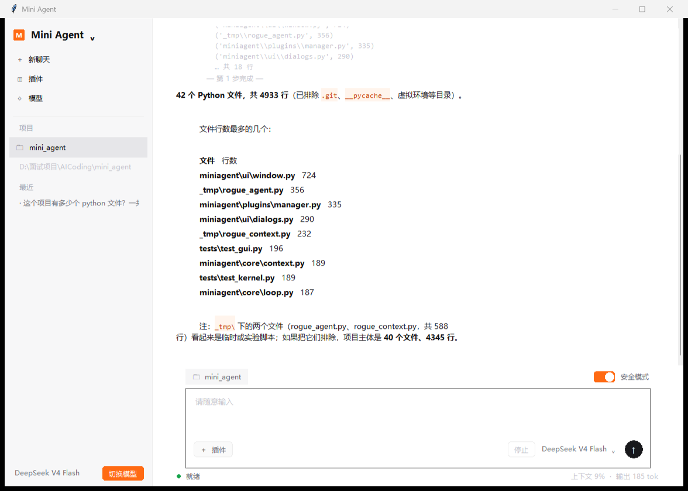

<p align="center">
  
</p>

<p align="center">
  <a href="https://github.com/Luo050129/-Agent/actions/workflows/ci.yml"></a>
  
  
  <a href="LICENSE"></a>
</p>

# 墟

墟是一个**零第三方依赖**的桌面 Agent：读文件、跑命令、接 MCP、从 GitHub 装插件和技能，改坏了能一键撤销。

内核是一个带自检的 ReAct 闭环——不是「问一次模型、打印一段文本」，而是「思考 → 动手 → 看结果 → 决定下一步」，直到它能**拿工具结果证明任务真的完成了**。

给它方向，不用给它脚本。它卡住会告诉你卡在哪、试过什么、下一步怎么办。

## 特性

- **双模式循环**：ReAct 边做边看，Plan 先出可验证的步骤清单再执行。
- **验证式自检**：交付前必须给出一个能证明完成的工具调用（读回文件、跑测试、列目录），内核真执行、用结果说话，失败自动返工。
- **六类跑飞熔断**：同一调用重复、反复失败、原地打转、工具预算、时间预算、连续被拒——到点收手并给人话报告。
- **进程级沙箱**：`run_python` 的子进程注入守卫，文件读写按白名单拦截，禁子进程与联网；`run_shell` 走 Job Object，超时杀整棵进程树。
- **会话存档 + 编辑撤销**：对话关窗不丢，`--resume` 接着聊；写文件前快照，GUI 一键撤销、CLI `/undo` 链式回退。
- **[MCP](docs/readme-legacy.md)**：接外部工具进程，工具清单按四层压缩，37 个工具从 6313 token 压到 1480。
- **插件与技能都从 GitHub 装**：插件给能力（`.py`），技能给方法（`.md`），子目录、单文件、本地路径都支持。
- **37 家供应商 4 种协议**：OpenAI Chat / Responses / Anthropic / Gemini，统一中间表示，加供应商只写适配器。
- **零第三方依赖**：只用 Python 标准库。clone 下来填个 Key 就能跑，没有 pip 地狱，没有供应链风险。

## 快速开始

```bash
git clone https://github.com/Luo050129/-Agent.git xu
cd xu
cp .env.example .env        # 填入 DEEPSEEK_API_KEY
```

图形界面（推荐）：

```bash
python gui.py             # Windows 双击「启动GUI.vbs」同效
pythonw gui.py            # 不弹控制台窗口
```

命令行：

```bash
python agent.py -p "统计这个项目有多少行代码"
python agent.py           # 交互模式，历史自动存档
python agent.py --resume  # 接着上次的会话聊
python agent.py --selftest  # 不需要 Key 的整链自检
```

需要 **Python 3.13+**。GUI 额外要求解释器带 `tkinter`——python.org 的官方安装包自带，部分精简版没有；缺了 CLI 照样能用。

交互模式的命令：

| 命令 | 作用 |
| --- | --- |
| `/undo` | 撤销 Agent 最近一次写文件 |
| `/skill <GitHub 地址>` | 装一个技能 |
| `/clear` | 开新会话（旧的留在历史里） |
| `/exit` | 退出 |

## 仓库结构

| 路径 | 作用 |
| --- | --- |
| [`miniagent/core`](miniagent/core) | 内核：循环、上下文预算、熔断、完成度判定、安全、持久化 |
| [`miniagent/model`](miniagent/model) | 模型层：统一事件流 + 4 个协议适配器 + 37 家供应商注册表 |
| [`miniagent/tools`](miniagent/tools) | 工具层：文件、命令、文档解析、沙箱、检查点 |
| [`miniagent/mcp`](miniagent/mcp) | MCP 传输与工具清单压缩 |
| [`miniagent/ui`](miniagent/ui) | tkinter 界面（三套主题 + 自绘控件）与 CLI |
| [`miniagent/plugins`](miniagent/plugins) · [`miniagent/skills`](miniagent/skills) | 扩展层：插件给能力，技能给方法 |
| [`tests`](tests) | 24 个套件、约 1000 项断言，全部零依赖 |
| [`ts-agent`](ts-agent) | **TypeScript 重写版**：同架构、零 npm 依赖，105 项测试，见 [ts-agent/README](ts-agent/README.md) |

## 文档

- [**从零造一个同款 Agent**](docs/agent-blueprint.md) —— 架构、模块复用清单、阈值依据、七步路线图，照着能复刻
- [技术细节与踩坑记录](docs/readme-legacy.md) —— 完整设计文档：循环流程、护栏推导、25 条真实踩坑
- [供应商与协议](docs/providers.md) —— 各家接口的差异与配置
- [系统分析](docs/system-analysis.md)

## 开发

```bash
python tests/test_kernel.py      # 单个套件，输出 PASS/FAIL 明细
python agent.py --selftest       # 无 Key 整链自检
```

不需要 `pip install`、不需要 pytest。CI 在 Linux 上跑全部非 GUI 套件（[workflow](.github/workflows/ci.yml)）。

## License

MIT，见 [LICENSE](LICENSE)。装进来的第三方插件与技能不在本协议覆盖范围内，以原作者协议为准。
