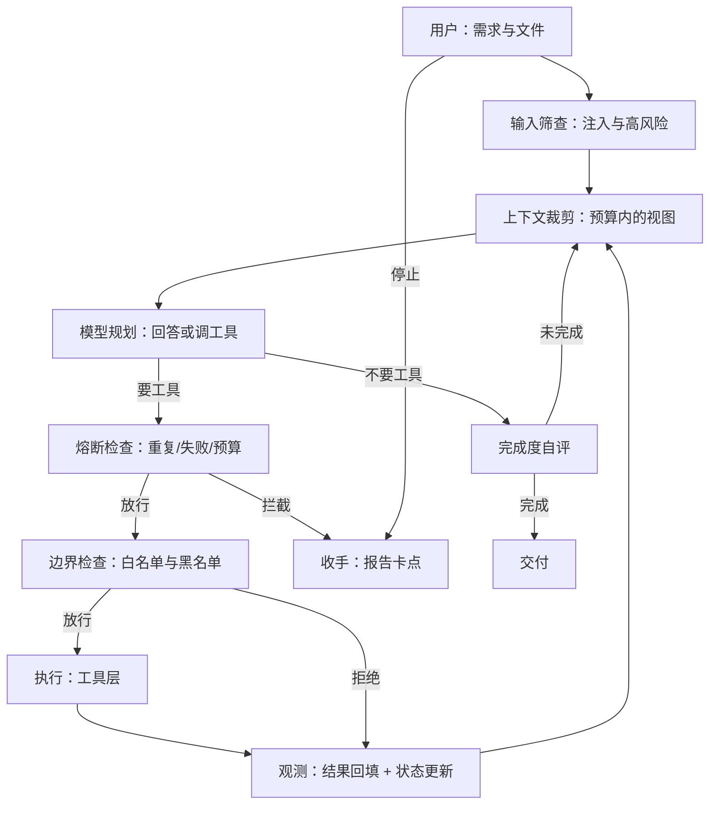

# Mini Agent 系统分析

用系统论描述，mini_agent 是：**以用户的自然语言需求（可附带文档）为输入，以大模型为决策组件，以工具为执行机构，以本机文件与进程为作用对象，通过带边界与熔断的反馈回路不断修正行为，并在无法收敛时主动交付"卡在哪"的单机人机协同系统。**

项目位于 `D:\面试项目\AICoding\mini_agent`，包内 4411 行、零第三方依赖、14 个测试套件（另有 1 个限额校准脚本）。以下分析全部对应到具体模块，不做悬空描述。

## 一、先确定系统边界

| 层次 | 包含什么 | 主要作用 |
| --- | --- | --- |
| Mini Agent 软件系统 | 内核循环、上下文管理、熔断、边界、工具、技能/插件、交互界面 | 组织任务执行过程 |
| 单个作业系统 | Mini Agent、模型服务、本机文件与进程、装进来的插件 | 完成一次具体任务 |
| 使用者的工作系统 | 人、任务目标、交付物、审计记录、机器权限 | 判断结果是否有用、是否可交付 |

**边界不同，责任也不同。** 它能执行命令，但命令的结果是否正确取决于环境；它能写文件，但文件该不该落地由人决定；它能自评"做完了"，但自评用的是同一个模型，不能替代人的验收。

这也是它和编码专用 Agent 的差别：编码 Agent 有编译、测试、CI 作为外部裁判，而通用 Agent 往往没有。mini_agent 因此把"验收"部分内化成了自评与熔断，代价是引入了自我确认偏差（见第九节）。

## 二、用"目标—要素—结构—环境"描述它

| 系统论概念 | 对 mini_agent 的解释 | 落在哪 |
| --- | --- | --- |
| 目标 | 把用户需求转化为可核验的产物：结论、文件、或明确的"做不到" | `core/loop.py` |
| 输入 | 自然语言、文档（docx/xlsx/pdf/文本/图片元信息）、技能、上下文、历史结果 | `tools/documents.py`、`skills/` |
| 要素 | 模型、工具、上下文管理器、状态观测、熔断器、边界策略、技能、插件、用户 | 见附录模块地图 |
| 结构 | 五层单向依赖 `ui → core → tools → (skills, plugins) → config`，核心层只认 `Sink` 事件 | `core/events.py` |
| 状态 | 任务状态快照、会话消息、上下文摘要、磁盘记录、插件与技能清单、工作区文件 | `core/state.py`、`core/context.py` |
| 输出 | 自然语言答复、文件、工具结果、token 与上下文用量、运行与审计记录 | `ui/window.py`、`.agent/records/` |
| 环境 | Windows + cmd.exe、Python 运行时、模型 API、`http_get` 网络、`rules.md` 运行时规则 | `core/prompt.py` |
| 约束 | 读写白名单、命令黑名单、安全模式、上下文预算 32k、步数/工具数/时长上限、熔断 | `core/rules.py`、`core/guard.py` |

要特别区分：**系统承担的"完成任务"，与模型每一步生成回答的机制并不等价。** mini_agent 的完成度是一个估算值（`completion.py`：规则快判 0.1~0.95 + 出口自评），它是启发式而非事实。

## 三、核心结构是一个带边界的反馈回路



它的反馈回路比"ReAct 循环"多了三个环节：**上下文裁剪**（决定模型能看到什么）、**边界检查**（决定能不能做）、**熔断检查**（决定还该不该继续）。多数简易 Agent 只有"调工具—回灌"这一环，能循环但不能收敛。

从控制论看各部分职责：

| 控制系统角色 | 在 mini_agent 中的对应 |
| --- | --- |
| 参考目标 | 用户需求 + `rules.md` 规则 + 边界策略 |
| 控制器 | 模型 + 内核循环（`loop.Agent`） |
| 执行机构 | `tools/` 的 shell、python、文件、文档、技能、插件 |
| 被控对象 | 本机文件、进程、网络请求 |
| 观测通道 | 工具返回值、`state` 快照、`.agent/records` |
| 上层监督 | 用户（停止/确认）、安全模式、白名单、审计日志 |

**能循环执行说明存在反馈；反馈是否带边界，决定它会不会跑飞。** 这是 mini_agent 与"几十行 ReAct demo"的本质区别：它把限制做成了独立模块，而不是指望模型自觉。

同一个内核还支持两种回路形态，可随时切换：

| 模式 | 回路结构 | 优点 | 风险 |
| --- | --- | --- | --- |
| ReAct | 短回路：每走一步就重新判断 | 灵活，适合探索 | 容易绕路，全局性差 |
| 计划执行 | 长回路：先固化成步骤，再逐步闭合；步骤失败时触发一次重规划（外层再多一层反馈） | 有全局结构，进度可见 | 多一次规划调用，简单任务反而慢 |

这对应控制论里的两种策略：**反馈式纠偏**（ReAct）与**前馈式规划 + 局部反馈**（Plan-and-Execute）。
前者靠快速试错，后者先建立参考轨迹再跟踪。选哪个取决于任务的不确定性——不确定就短回路，可拆就先规划。

## 四、它是"部分可观测"的动态系统，而且观测是被裁剪过的

模型看不到整个工作区，只看到：读过的文件、工具返回的内容、以及**当前上下文视图里保留下来的部分历史**。可写成一个简化模型：

```
o_t = H(e_t)              通过工具获得的观测
c_t = T(h_{0..t}, B)      预算 B 下裁剪后的上下文视图
a_t = π_θ(g, c_t, o_t)    本轮选择的行动
e_{t+1} = F(e_t, a_t, d_t) 真实环境的演化
```

其中 `T` 是裁剪算子（`core/context.py`），这是 mini_agent 与 Pi 的一个差异点：**它的上下文不是"历史全量"，而是"预算内的投影"**。于是它多出两类认知偏差：

| 偏差来源 | 机制 | 后果 |
| --- | --- | --- |
| 裁剪失真 | 超预算后旧消息被压成 `[早期上下文摘要]`，只保留用户请求、工具计数与结论片段 | 早期约束可能丢失，出现"前后不一致" |
| 计量误差 | token 用"中文 1 字≈1、英文 4 字符≈1"粗估 | 预算判断是近似的，长英文内容可能低估 |

这两点都不是 bug，是有意识的设计取舍：**用可控的失真换取不会撞窗口**。摘要规则是确定性的、可审计的，比"让模型自己总结"更可预测。

## 五、五类状态必须分开看

| 状态类型 | 在 mini_agent 中的载体 | 主要问题 |
| --- | --- | --- |
| 对话与认知状态 | `Session.messages`（内存） | 关窗即失忆，无持久化 |
| 上下文预算状态 | `ContextStats`（tokens/预算/丢弃数） | 只是估算值，不代表模型真实占用 |
| 文件状态 | 工作区真实文件 | 与对话记录可能不一致（写完没记录、记录完没写成功） |
| 进程与外部状态 | 子进程、网络请求 | 工具超时或中断后，外部副作用可能已发生 |
| 审计与运行记录 | `.agent/records/*.jsonl`、`audit-*.jsonl` | 只有工具调用粒度，没有完整会话回放 |

**记录存在不等于状态可恢复。** 现在它能回答"这一步干了什么"，但回答不了"上次那个任务怎么继续"——会话没有落盘，这是第九节列的第一个缺口。

## 六、能力来自组合，也受短板限制

| 要素 | 能力不足时的表现 | 在 mini_agent 里的具体形态 |
| --- | --- | --- |
| 模型判断 | 误解需求、选错方向 | 换模型即可缓解，目录里 48 个模型 / 37 家供应商 / 4 种协议可切 |
| 上下文质量 | 遗漏约束、反复探索 | 超出 32k 后摘要会丢细节 |
| 工具能力 | 拿不到信息、做不成事 | 图片读不了画面、扫描件 PDF 要 OCR |
| 环境可靠性 | 构建失败、结果不可复现 | shell 走 cmd.exe；工具默认 60s 超时 |
| 反馈质量 | 错误未被发现，形成虚假完成 | 自评用的是同一个模型，会自我确认 |
| 验收机制 | 局部通过但目标未达成 | 通用任务没有 CI，只能靠人 |

**"换个更强的模型"只能改善前两行。** 后四行属于系统结构问题：工具能力要靠加工具或插件，反馈质量要靠外部判据，验收要靠人。

## 七、它额外做了一层"防跑飞"，这是相对多数 Agent 的结构性差异

| 风险 | 机制 | 默认值 | 依据 |
| --- | --- | --- | --- |
| 工具无限循环 | 同一「工具+参数」计数，超限当场收手 | 3 次 | 相同调用第 2 次信息增益≈0 |
| 反复失败还硬试 | 同一调用失败计数，超限禁止再试 | 2 次 | 1 次容错 + 1 次确认 |
| 原地打转 | 连续相同结果判定无进展 | 4 次 | 3 次成立 + 1 次容错 |
| 工具刷屏 | 单任务工具调用总数 | 40 次 | 单步≈1.8k token，40×1.8k≈预算的 2.2 倍 |
| 任务太久 | 墙钟时间预算 | 300s | 单工具最长 60s，至少容 3 次超时 |
| 模型慢/卡死 | 读超时 + 单次总时限 + 退避重试 | 60s / 180s / 2 次 | 网络抖动实测可达 16s |
| 恶意输入 | 注入与高风险模式筛查 → 加固系统提示 + 审计 | — | 不拒绝对话，只收紧边界 |
| 敏感操作 | 安全模式确认 + 风险说明 | GUI 默认开 | 覆盖/网络/删除/执行代码分别提示 |
| 边界冲突 | 拒绝并回灌原因，连续被拒则收手 | 3 次 | 同一错误重试无意义 |

关键点：**收手不抛异常，而是产出一份人话报告**（卡在哪、试过什么、下一步）。这把失败模式从"报错崩掉"变成"有限度地交付"。

## 八、判断它是否有效，要看收敛而不是活跃程度

| 维度 | 应观察的证据 | mini_agent 里的可观测点 |
| --- | --- | --- |
| 目标一致性 | 答复是否对应原始需求 | `Session.messages` 里的 user 原话 vs 最终回答 |
| 可观测性 | 关键结论是否有工具结果支撑 | 每步 `state` 快照、`records` 里的 args/result |
| 可控性 | 能否限制、纠偏、停止 | 停止按钮、安全模式、白名单、熔断、`cancel` 事件 |
| 收敛性 | 每轮是否减少未解决问题 | 熔断计数、重复调用次数、无进展计数 |
| 验收有效性 | 检查是否覆盖真实目标 | 自评 + 启发式（弱项，见下） |
| 资源效率 | 时间、token、上下文占比 | 界面底部「上下文 x% · 输出 n tok」 |

工具调用很多、解释很长，并不代表接近目标。**能停下来，也是能力的一部分。**

## 九、已知缺口（按影响排序）

| 缺口 | 影响 | 代价/说明 |
| --- | --- | --- |
| 会话不持久化 | 关窗即失忆，长任务无法续跑 | 需要 messages 落盘 + 恢复语义，工作量小 |
| 自评用同一个模型 | 自我确认偏差，"说完成"不等于完成 | 换模型交叉验证或多轮检查 |
| 无沙箱 | 边界是启发式白名单，`python -c` 里的越界写法拦不住 | 真要隔离得上容器/虚拟机 |
| 图片与扫描件 | 只能给尺寸，OCR 做不了 | 需要视觉模型或 OCR 依赖 |
| 摘要为规则抽取 | 丢语义细节，长任务易前后不一致 | 可换 LLM 摘要，但要花 token |
| 无子 Agent / MCP | 复杂任务只能平铺推进 | 属于能力扩展，非缺陷 |

## 十、把它放在什么位置用

mini_agent 的定位不是"无人值守的自动化平台"，而是**个人桌面上的"能动手的助手"**：单机、单任务、人可以随时介入和确认。

- 适合：查资料、读文档、统计与整理、改自己的代码、装插件扩能力
- 需谨慎：批量改文件、跑长命令、装来源不明的插件（有确认与审计，但没有隔离）
- 不适合：无人值守的高危操作、多人协作场景、需要强审计与回滚的生产环境

如果要做成团队级工具，需要补的是隔离（容器）、持久化（会话与工作区快照）、身份与权限分级、以及独立于模型的结果验证 —— 这些都不是"换个更强的模型"能替代的。

## 附录：模块地图（行数为实测）

| 文件 | 行数 | 职责 |
| --- | --- | --- |
| `ui/window.py` | 772 | 主界面：侧栏、对话、输入卡、状态栏 |
| `tools/documents.py` | 435 | docx / xlsx / pdf（含 ToUnicode）/ 图片元信息 |
| `plugins/manager.py` | 335 | 插件安装、启停、加载 |
| `ui/dialogs.py` | 290 | 插件管理窗口 |
| `core/loop.py` | 249 | 内核循环（ReAct + 边界 + 熔断 + 自评） |
| `model/client.py` | 215 | 流式客户端，超时/重试/停滞检测 |
| `core/guard.py` | 204 | 熔断与限流 |
| `core/context.py` | 204 | token 估算、裁剪、摘要、记录 |
| `core/rules.py` | 186 | 规则边界与权限边界 |
| `ui/widgets.py` | 185 | 圆角按钮、开关、侧栏条目 |
| `ui/console.py` | 168 | 命令行界面 |
| `core/safety.py` | 119 | 输入筛查与审计 |
| `skills/manager.py` | 112 | 技能发现与解析 |
| `core/completion.py` | 73 | 完成度快判与出口自评 |
| `model/registry.py` | 208 | 供应商目录（48 个模型 / 37 家供应商 / 4 种协议） |
| `model/protocols/` | 725 | 四套原生协议适配器（openai / anthropic / gemini / responses） |
| `model/client.py` | 216 | 传输：请求、重试、超时、拼流（不认识任何供应商） |
| `model/wire.py` | 78 | 协议无关的统一事件与请求结构 |
